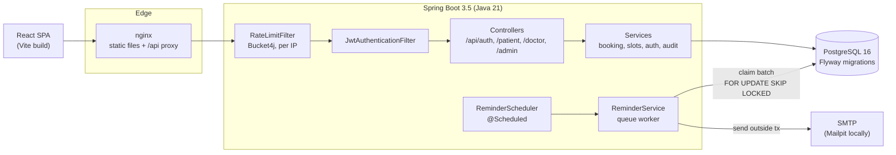
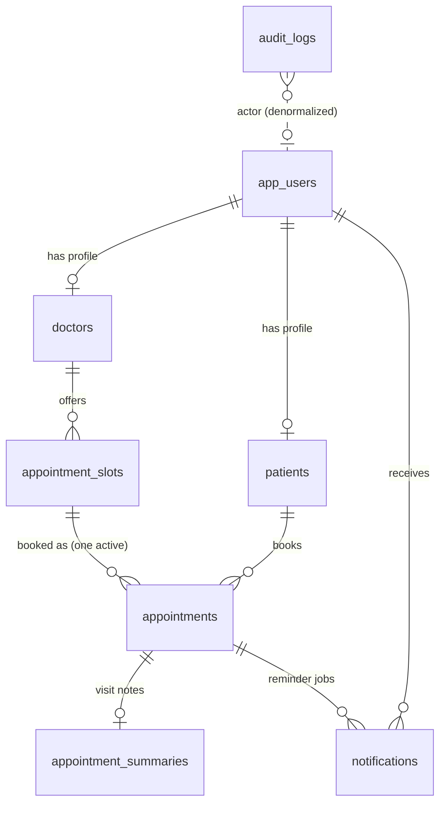
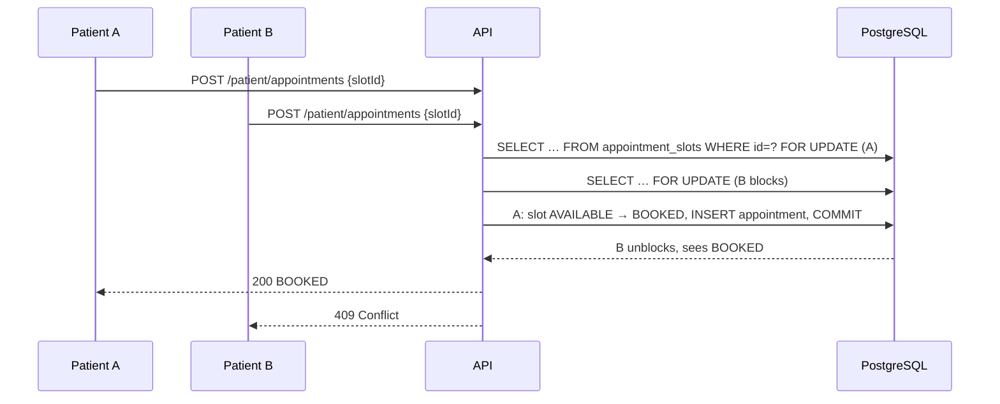
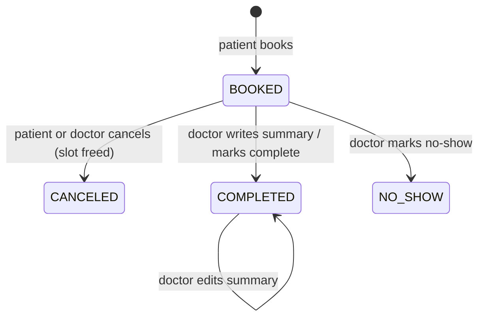
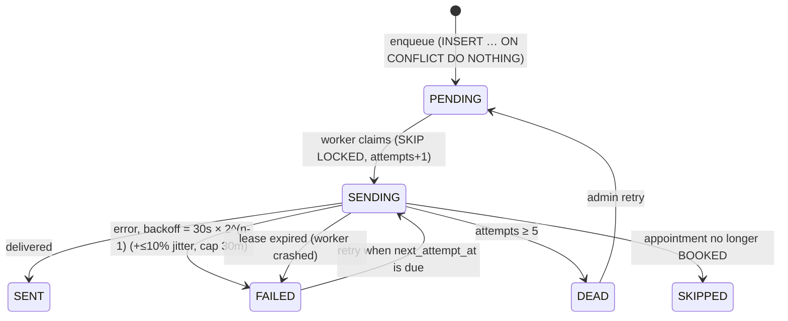

# Architecture

> CareSlot is a **demo system with synthetic data**. It is not a clinical product and is not HIPAA compliant.

## System overview



In local Docker Compose, nginx serves the SPA and proxies `/api` so the browser sees a single origin.
In the hosted demo, the SPA is on Vercel and calls the API directly (CORS allow-list via `FRONTEND_URL`).

## Backend layout

```
backend/src/main/java/com/example/healthcare/
├── config/        Security chain, CORS, rate limiter, clock/timezone, OpenAPI, typed properties
├── security/      JWT issue/verify, user principal, auth filter
├── controller/    REST endpoints (thin: validate, delegate)
├── service/       Business rules, transactions, audit logging
├── notification/  Reminder queue: enqueue, worker, senders (log / SMTP)
├── repository/    Spring Data JPA + native SQL for the queue
├── entity/, enums/, dto/
├── exception/     ApiException + global JSON error mapping
└── seed/          Demo accounts; synthetic dataset (demo profile)
```

## Data model



Schema changes are versioned Flyway migrations (`db/migration/V1__…`, `V2__…`); Hibernate only validates.

## Key flows

### Booking a slot (double-booking protection)



Two independent layers:
1. **Pessimistic row lock** on the slot serializes concurrent bookers.
2. **Partial unique index** `uk_appointments_active_slot ON appointments(slot_id) WHERE status <> 'CANCELED'`
   rejects any second active appointment even if a code path forgot the lock (mapped to HTTP 409).

Cancellation also locks the appointment row and only transitions `BOOKED → CANCELED`, so a repeated
cancel can never free a slot that another patient has since rebooked.

### Appointment state machine



### Reminder queue

The `notifications` table doubles as a durable job queue, so no extra broker is needed.



- **Enqueue** (every minute): one set-based `INSERT … SELECT` for booked appointments starting in the next 24h.
  A unique `(appointment_id, type)` constraint makes it idempotent across runs and instances.
- **Claim** (every 5s): `UPDATE … WHERE id IN (SELECT … FOR UPDATE SKIP LOCKED LIMIT 50) RETURNING id`.
  Concurrent workers get disjoint batches without blocking.
- **Send** happens *outside* any transaction, so a slow SMTP server never holds DB locks.
- **Lease recovery**: jobs stuck in `SENDING` for over 5 minutes (crashed worker) return to the retry queue.
- **Observability**: Micrometer counters `notifications.processed{result}` and timer `notifications.send`
  (`/actuator/metrics`, admin only); admin UI shows the queue and can requeue dead jobs.

Delivery is at-least-once: if a worker crashes after SMTP accepted the message but before marking it SENT,
the lease expires and the reminder is sent again. That is the right trade-off for reminders.

## Time handling

Slot times are clinic wall-clock times stored as `TIMESTAMP` (no zone). `CLINIC_ZONE` sets the zone,
and the JVM default zone is aligned to it at startup so every "now" agrees (services, entity timestamps,
Bean Validation). See `TimeConfig`.

## Profiles

| Profile | Purpose |
|---|---|
| *(default)* | Local development: dev JWT secret allowed, demo accounts seeded, log-only notifications |
| `demo` | Also generates the synthetic dataset (12 doctors, 200 patients, ~3k slots, ~2.4k appointments) |
| `prod` | Refuses to start with the dev JWT secret; quieter logging |
| `test` | Testcontainers PostgreSQL, scheduler off, fast BCrypt, zero backoff |
